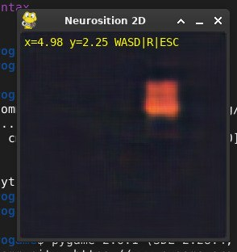
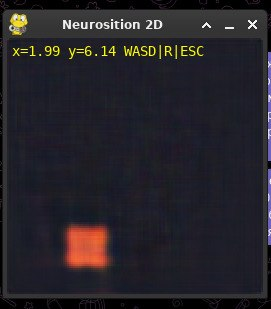

# Neurosition

**Neural Rendering By 2D Position**

Neural rendering: a network is trained on screenshots of a game/program along with the position parameters attached to them.

## How does it work?

1. Collect screenshots/any suitable images + coordinates into `coords.csv`.
2. `prepare.py` compresses frames to SIZE*SIZE (128x128 by default) (ffmpeg, nearest-neighbor) and builds `dataset.pt`.
3. `train.py` trains a CoordConv + U-Net model.
4. `play.py` launches a walk through the neural-generated world.

| Screenshots |  |
|---|---|
|  |  |

## Quick start

```bash
git clone https://github.com/seal29-idk/Neurosition
cd Neurosition

python3 -m venv venv
source venv/bin/activate
pip install -r requirements.txt

# Generates a basic minimal dataset of 64 cubes (saved to raw/ and also edits coords.csv)
python3 cubes.py

# Creates a dataset in the format for model training (takes from raw/ and saves scaled to dataset/, and also creates the dataset.pt tensor)
python3 prepare.py

# Train on the dataset (uses dataset/, coords.csv)
python3 train.py

# Run the trained Neurosition model from checkpoints/best.pt (Important note: by default it runs in CPU mode and at 5 FPS)
python3 play.py
```


# Neurosition

**Neural Rendering By 2D Position**

Нейрорендер: сеть обучается на скриншотах игры/программы с приложенными к ему параметрами позиции

## Как это работает?

1. Собираешь скриншоты/любые подходящие изображения + координаты в `coords.csv`.
2. `prepare.py` сжимает кадры до SIZE*SIZE (128x128 по дефолту) (ffmpeg, nearest-neighbor) и собирает `dataset.pt`.
3. `train.py` обучает модель CoordConv + U-Net
4. `play.py` запуск прогулки по нейрогенерируемому миру

| Скриншоты |  | 
|---|---|
|  |  |

## Быстрый старт

```bash
git clone https://github.com/seal29-idk/Neurosition
cd Neurosition

python3 -m venv venv
source venv/bin/activate
pip install -r requirements.txt

# Генерирует базовый минимальный датасет на 64 куба (сохраняется в raw/ а также редактирует coords.csv)  
python3 cubes.py

# Создание датасета в формате для обучения модели (берет из raw/ и сохраняет маштабируя в dataset/ а также создает тензор dataset.pt )
python3 prepare.py

# Обучить датасетом (используется dataset/,coords.csv)
python3 train.py

# Запустить обученную модель Neurosition из checkpoints/best.pt (Важное уточнение по умолчанию стоит режим CPU и 5 FPS) 
python3 play.py
```
